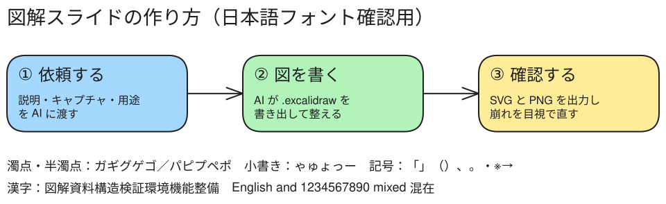

## 図解スライドの作り方

::: {.tside}
::: {.tmain}
```{=html}
<span hidden></span>
```
### 流れ

- 説明・キャプチャ・用途を AI に渡す
- AI が .excalidraw を書く
- SVG と PNG を出し、崩れを目視で直す

:::
::: {.tright}
```{=html}
<figure><figcaption>Excalidraw から保存した SVG（日本語フォント確認用）</figcaption></figure>
```

:::
:::
```{=html}
<div class="lid">T+side</div>
```
